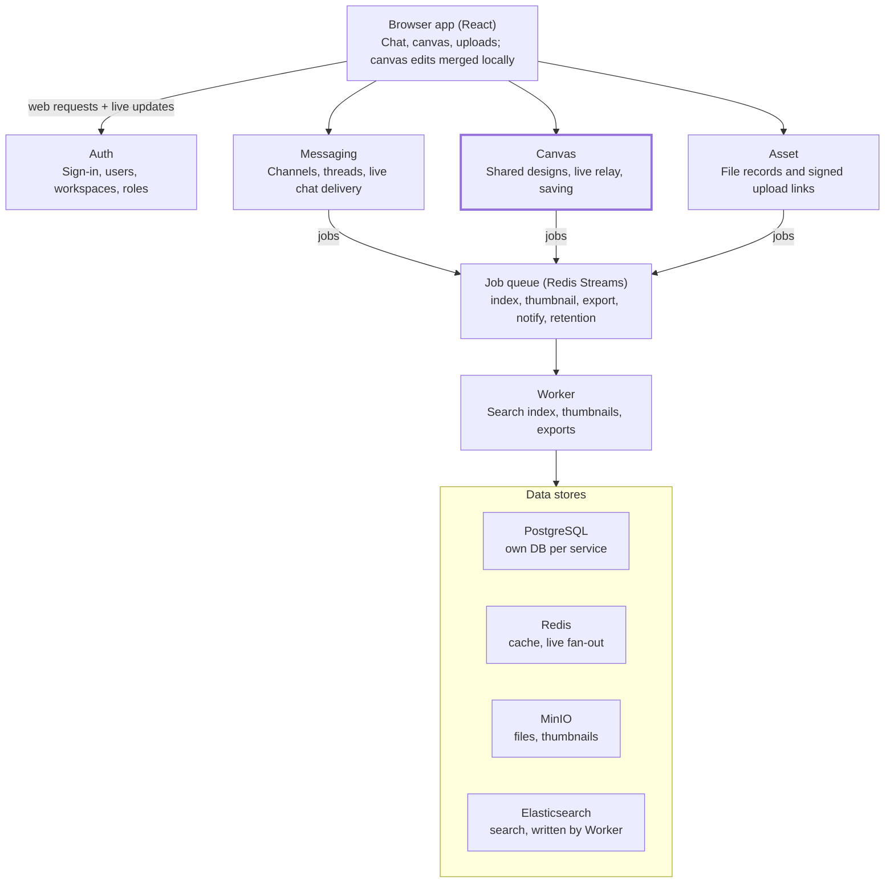

# CollabHub — Application Overview

> Stakeholder summary of the design documents in this folder. As of 2026-11-20.
> Build timeline and effort: see [09-build-phases-estimate.xlsx](./09-build-phases-estimate.xlsx).

## Summary

CollabHub is a single web app that combines Slack-style team chat with a Figma-style collaborative design canvas, so a team can talk and design in one place. It is built as five independent backend services plus one browser app, designed to run on the company's own Kubernetes cluster first and move to Azure later without code changes.

The design is at draft stage: the technology choices are settled (Python backend, React frontend, decided 2026-11-19), and about 30 decisions remain open, seven of which span several services and should be settled before the build starts in earnest.

## What users get

| Capability | What it does for the user |
| --- | --- |
| Team chat | Public and private channels, direct messages, single-level threads, emoji reactions, read receipts and typing indicators, delivered live in under half a second. |
| Collaborative canvas | Several people edit the same design document at once and see each other's cursors live; edits never conflict or overwrite each other. |
| Files and images | Upload attachments, images, fonts and avatars; thumbnails are generated automatically. Large files go straight to storage, so uploads stay fast. |
| Search | Search across messages and files (canvas content search is still an open decision). |
| Sign-in | Single sign-on through the company's existing identity provider; enterprise SAML login is optional. |
| Workspaces and roles | Users belong to a workspace with owner, admin, member or guest roles; channels and documents can be shared more narrowly. |
| Exports and notifications | Export a canvas to PNG, SVG or PDF; notifications for mentions and DMs (channels for v1 still to be decided). |
| Mobile | A mobile path is planned, either as an installable web app or a React Native app (open decision). |

## How it is built

The browser app talks to four services over web requests and live connections; those services hand slow work to a job queue that the Worker processes in the background.

Canvas (highlighted) carries the most technical risk. Each service owns its own database; the Worker never touches those databases and reports results back through the owning service. Files travel directly between the browser and file storage, not through the services.

## Key design choices and why they matter

- **Independent services, separate data.** Each service owns its own database and is deployed on its own, so teams can build, release and scale parts separately, and a fault in one area is contained.
- **Sign-in checked locally.** Every service verifies a user's login token itself rather than calling the Auth service each time. This keeps the app fast and resilient; the trade-off is that a revoked login can stay valid for up to 15 minutes if the revocation cache is unreachable.
- **The canvas merges edits in the browser.** Conflict-free editing is handled by a proven open-source library (Yjs) running on each user's device; the server only relays and saves changes. This removes the hardest engineering problem from the backend.
- **Files bypass the servers.** Browsers upload and download directly to storage using short-lived signed links, so file size never affects server load.
- **Heavy work runs in the background.** Search indexing, thumbnails, exports and clean-up go through a job queue to the Worker, which scales up automatically with demand and down to zero when idle.
- **Cloud-portable by design.** Only standard, vendor-neutral interfaces are used (S3-style storage, Kubernetes, OpenTelemetry), so the move from on-premises to Azure is a configuration change, not a rewrite.

## Quality targets

| Measure | Target |
| --- | --- |
| Chat message delivery (end to end) | Under 500 ms for 99% of messages |
| Canvas edit relay | Under 500 ms for 99% of edits |
| Sign-in token issue | Under 100 ms for 99% of requests |
| Notification delivery | Under 5 s for 95% of notifications |
| Canvas drawing speed | 60 frames per second with several live cursors |
| Limits | 8,000-character messages, 10 attachments per message, about 25 MB per canvas document, about 50 MB per upload |

## Decisions needed from stakeholders

These seven decisions cut across services and should be settled before Phase 1 ends; the rest can wait for later phases. IDs refer to the [open decisions register](./07-open-decisions-register.md).

| ID | Decision | Current assumption | Why it matters |
| --- | --- | --- | --- |
| D2 | Can a user be active in more than one workspace at a time? | One workspace per sign-in | Shapes the login token and every permission check |
| D1 | How strictly to enforce logout across services | Check a revocation list, accept the risk if it is down | A security trade-off that needs explicit sign-off |
| D27 | Real-time technology | Socket.IO | Affects chat, canvas, frontend and network setup |
| D9/D10 | How canvas documents are stored | Binary snapshots plus a change log | Determines durability if a server crashes mid-edit |
| D14 | How the Worker reports results back | Internal service endpoints | Keeps service data separate |
| D12 | Whether canvas content is searchable in v1 | Not decided | Adds work to Canvas and Worker if yes |
| D26 | Who runs data retention clean-up | Worker coordinates, each service deletes | Needs concrete retention periods (D16) |

Product-scope decisions that change the plan's size: SAML login in v1 (D6), notification channels in v1 (D18), canvas export engine (D19, may be deferred), and mobile approach (D20).

## Risks and next steps

- **Canvas is the riskiest area.** Live multi-user editing, crash-safe saving and fast drawing are the hardest parts; the plan builds them early so problems surface while there is time to adjust.
- **Canvas export is non-trivial.** Rendering designs to PNG/PDF on the server has no settled approach; deferring it past v1 is a realistic option.
- **Open decisions can cause rework.** The workspace model (D2) in particular touches every service; deciding it late means revisiting finished code.
- **Lost background jobs.** The current design can drop a search-index or notification job if the queue fails at the wrong moment; a safer pattern (D28) adds some effort.

Next steps: confirm the seven cross-cutting decisions, agree v1 scope on SAML, notifications, export and mobile, then start Phase 0 of the [build phases estimate](./09-build-phases-estimate.xlsx) (likely 39 weeks to on-prem launch with about 5 engineers, range 29 to 56).
